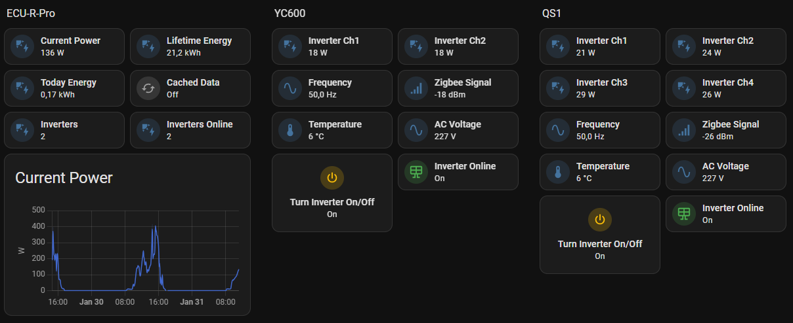

[](https://github.com/haedwin/homeassistant-apsystems_ecu_reader)
[](https://github.com/HAEdwin/homeassistant-apsystems_ecu_reader/actions/workflows/validate%20with%20Hassfest.yaml)
[](https://github.com/HAEdwin/homeassistant-apsystems_ecu_reader/actions/workflows/validate%20with%20HACS.yaml)
[](https://github.com/haedwin/homeassistant-apsystems_ecu_reader)
[](https://www.home-assistant.io/integrations/marketplace)


# APsystems ECU Reader

> Over 1000 (measured) active installations, the estimated total number of users is 4,000+.
> If this integration’s been helpful, I’d truly appreciate a ⭐ star—it means a lot and helps others discover the project too!
> And if you’d like to support future updates and improvements, you can always buy me a coffee ☕. Thanks so much for your support!



## Overview

APsystems ECU Reader is a custom Home Assistant integration project for communicating with APsystems ECU hubs.
> [!IMPORTANT]
> for solar installations only (not the APsystems APstorage systems like the ELS or ELT series). The use of the ECU-C in these series is not intended for a PV installation.
> Use the https://github.com/Echo000926/APsystemsStorageHAPublic integration for APsystems storage units.

> [!TIP]
> For EZ1 microinverters use the integration at: https://www.home-assistant.io/integrations/apsystems/.

The APsystems ECU Reader is an extended and improved version of ksheumaker's "homeassistant-apsystems_ecur" integration.

Key features include:
- Robust data integrity checks
- Enhanced communication control with the ECU
- Individual inverter on/off switching (ECU-R-Pro series starting with 2162 and ECU-C only)
- Improved error handling and query efficiency
- Support for L2 and L3 voltages (three-phase inverters)
- Multiple ECU hub support
- Individual inverter online sensors for automations
- Near zero Export capability (ECU-R-Pro series starting with 2162 and ECU-C only). Read [the Wiki](https://github.com/HAEdwin/homeassistant-apsystems_ecu_reader/wiki/Automation-examples#grid-zero-control) for script.
- Per-panel maximum power limiting (ECU-R-Pro, ECU-C, ECU-3)
- Zigbee signal strength in dBm

> **Note:**
> For in-dept information about sensors etc. please read [the Wiki](https://github.com/HAEdwin/homeassistant-apsystems_ecu_reader/wiki) on this project page.
> This integration is not compatible with any ECU-C mounted in the APsystems storage solutions.

---

## Prerequisites

- Supported ECU models: ECU-B, ECU-R, ECU-C (with YC600, YC1000/QT2, DS3, QS1 series inverters).
- ECU must be connected to your LAN with a fixed IP address.
- Home Assistant must have network access to the ECU.
- Home Assistant 2026.11 or later (built-in **Marketplace**), or HACS installed if you run an older Home Assistant version.
- Home Assistant log should not show repetitive errors that could cause resource exhaustion.

| Connection Required | ECU Model                  | Automated Restart* |
|---------------------|---------------------------|--------------------|
| Wireless            | ECU-R (2160 series), ECU-B| No                 |
| Wireless/Wired      | ECU-R (2162 series)       | Yes                |
| Wireless/Wired      | ECU-C                     | Yes                |

_ECU-3 owners: See [ha-apc-ecu-3](https://github.com/jeeshofone/ha-apc-ecu-3)_

---

## Wireless ECU Setup

1. **Install EMA Manager**: Download from your app store.
2. **Access Point Mode**: Press and hold the ECU-R button until Wi-Fi starts.
3. **Connect to ECU-R Wi-Fi**: Default password is `88888888`.
4. **Launch EMA Manager**: Choose "Local" connection.
5. **Configure Network**: Connect ECU-R to the same Wi-Fi as Home Assistant.

---

## Testing ECU Connection

Find your ECU on the network (look for "Espressif Inc." or "ESP").  
Test with ping or Netcat:
```
nc -v <ECU_IP> 8899
APS1100160001END
APS11009400012160000xxxxxxxz%10012ECU_R_1.2.22009Etc/GMT-8
```
Preferably assign a fixed IP address to the ECU. Make sure you have the correct ECU.

---

## Required Ports for proper EMA upload and firmware updates 

| Domain                | Ports                                      | Protocol |
|-----------------------|--------------------------------------------|----------|
| ecu.apsystemsema.com  | 8995, 8996, 8997, 8998, 9227, 9228, 9001-9004 | TCP      |
| ecu2.apsema.com       | 9220, 9222                                 | TCP      |
| ecu2.apsema.com       | 9219, 21                                   | FTP      |
| ecuna.apsema.com      | 9220, 9222                                 | TCP      |
| ecuna.apsema.com      | 9219, 21                                   | FTP      |
| ecueu.apsema.com      | 9220, 9222                                 | TCP      |
| ecueu.apsema.com      | 9219, 21                                   | FTP      |

---

## Installation

As of Home Assistant 2026.11, the **Marketplace** (built into Home Assistant) replaces HACS as the way to discover and install community integrations. If you are still on an older Home Assistant version, use HACS instead.

1. **Via the Home Assistant Marketplace** (Home Assistant 2026.11 or later):
   - Go to **Settings** > **Marketplace**.
   - Use **Search** for "APsystems ECU Reader". If it does not show up in the catalog yet, select the **⋮** menu in the upper-right corner, choose **Add from link**, and enter `https://github.com/haedwin/homeassistant-apsystems_ecu_reader`.
   - Open the repository page and select **Install**, then confirm.
   - If prompted, restart Home Assistant.
   - Go to **Settings** > **Devices & services** > **+ Add integration**, search for "APsystems ECU Reader" and select it.
   - Now follow the Configuration Options guide below.

2. **Via HACS** (Home Assistant versions before 2026.11):
   - Search for "APsystems ECU Reader" in HACS.
   - Click on the integration and choose the [Download]-button in the lower right corner.
   - After downloading, a message appears reminding you to restart HA - restart HA.
   - After restart go to [Devices & Services] and choose the [+ Add integration]-button in the lower right corner.
   - In "Search for a brand name" enter "APsystems ECU Reader" and select the integration.
   - Now follow the Configuration Options guide below.

> **Note:**  
> If you are not able to connect to the ECU, read this manual and prerequisites. 
> For more guidance use [the wiki](https://github.com/HAEdwin/homeassistant-apsystems_ecu_reader/wiki).

---

## Removal / Uninstalling the integration

To fully remove APsystems ECU Reader:

1. **Remove the integration entries**:
   - Go to **Settings** > **Devices & services**.
   - Select the **APsystems ECU Reader** integration and remove each configured entry (⋮ menu > **Delete**) for every ECU hub you added. This also removes its devices and entities.

2. **Uninstall the integration files**:
   - **Via the Marketplace** (Home Assistant 2026.11 or later): Go to **Settings** > **Marketplace**, open the **APsystems ECU Reader** repository page, select the **⋮** menu, then **Uninstall**, and confirm. If the integration still has a configured entry, the Marketplace asks you to remove it first or offers **Delete and uninstall** to do both in one step.
   - **Via HACS** (Home Assistant versions before 2026.11): Open HACS, find **APsystems ECU Reader**, select the **⋮** menu, then **Remove**, and confirm.
   - **Manually** (if installed without the Marketplace or HACS): Stop Home Assistant and delete the `apsystems_ecu_reader` folder from your `custom_components` directory.

3. **Restart Home Assistant** so it no longer loads the removed integration.

> **Note:**  
> No additional `configuration.yaml` entries, helpers, or long-term statistics are created by this integration outside of what is managed by the config entry above, so no extra cleanup is required.

---

## Configuration Options

- **ECU-IP address**: Enter your assigned ECU IP.
- **Query interval**: Recommended: 300 seconds.
- **Retries**: Number of connection attempts before using cache.
- **Cache count before auto reboot**: For ECU-R-Pro & ECU-C.
- **Update graphs when inverters offline**: On/Off.
- **SSID and Password**: For forced ECU reboot (ECU-R-Pro & ECU-C).

---

## Feature Compatibility

| Type    | Entity                        | ECU-B | ECU-R | ECU-R-Pro | ECU-C |
|---------|-------------------------------|-------|-------|-----------|-------|
| switch  | ecu_{ECU-ID}_zero_export      | No    | No    | No        | Yes   |
| switch  | inverter_{Inverter-ID}_on_off | No    | No    | Yes       | Yes   |
| button  | ecu_{ECU-ID}_reboot           | No    | No    | Yes       | Yes   |
| number  | inverter_{Inverter-ID}_maxpwr | No    | No    | Yes       | Yes   |
| number  | ecu_{ECU-ID}_power_limit      | No    | No    | No        | Yes   | 

---

## Troubleshooting

- If frequent cache usage or crashes occur, check [Settings] > [System] > [Logs] for errors.
- Disable integrations that are causing connection/communication errors.
- Choose the best location for your ECU where it has the best reception for both Zigbee and WiFi.
- Make sure that nothing is blocking the reception of the signals.
- Check if the firmware has been changed.

## Data cache is used if

- The integration cannot connect to the ECU
- Received data is incomplete
- A timeout occurs
- Another error occurs

However, this does not prevent the integration from continuing to function normally unless the ECU hangs then use the "Using Cache Counter" entity.
The idea behind this entity is that you can use it to decide when to reset the ECU because it has apparently frozen. During the configuration of the hub/ECU, you can set when the 2162 and the ECU-C reset via software. You will need to reset the ECU-B and the standard ECU-R using automation and a smart plug.

Work is underway on a structural solution.
If you really can't figure it out, create an issue and remember that the more time you spend specifying the problem, the faster and more precise the answer can be.

---

## Temperature Sensors

If inverter temperature returns zero when offline, use a template to convert non-numeric values:
```yaml
template:
  - sensor:
      - name: "Temperature non numeric 4080xxxxxxxx"
        state: "{{ states('sensor.inverter_4080xxxxxxxx_temperature')|float(0) }}"
        unit_of_measurement: "°C"
      - name: "Temperature non numeric 8060xxxxxxxx"
        state: "{{ states('sensor.inverter_8060xxxxxxxx_temperature')|float(0) }}"
        unit_of_measurement: "°C"
```

---

## Additional Resources

- For in-depth information on available sensors, read the [Wiki](https://github.com/HAEdwin/homeassistant-apsystems_ecu_reader/wiki)
- [German Guide](https://smart-home-assistant.de/ap-systems-ecu-b-einbinden)
- [Dutch Guide](https://doe-duurzaam.nl/artikel/je-apsystems-micro-omvormers-slim-uitzetten-via-web-of-home-assistant/#teruglevering-beperken-per-micro-omvormer)

---

## FAQ

**Why is my inverter offline during the day?**  
- Possible Zigbee signal loss or poor reception.  
- Overvoltage due to wiring or grid conditions.

**Why do ECU values differ from EMA values?**  
- Sampling frequency and CT location differences.

**Why can't the integration find my ECU?**  
- Network configuration issues or ECU not running long enough.

---

## Acknowledgements

Developed in collaboration with checking12, ksheumaker, HAEdwin, and the Home Assistant community.  
Special thanks to 12christiaan, ViperRNMC, and all sponsors for their support!
